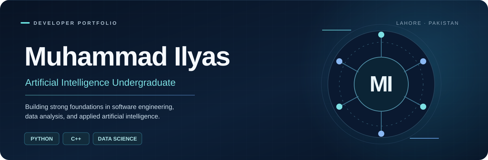

<!-- Muhammad Ilyas | Developer Profile -->

  
  

## Profile

I am **Muhammad Ilyas**, a fifth-semester **BS Artificial Intelligence** student at the **University of Central Punjab (UCP), Lahore**.

My work is rooted in programming fundamentals, object-oriented design, and practical problem-solving. I build C++ projects, study Python and data analysis, and explore how these foundations apply to machine learning and software systems.

> My approach: understand the fundamentals, build working software, document what I learn, and improve through iteration.

## Technical Toolkit

**Programming**

**Data analysis and scientific computing**

**Tools and environments**

**Currently learning:** machine learning fundamentals, SQL, Apache Spark, and PySpark.

## Selected Work

<table>
<tr>
<td width="50%" valign="top">
<h3>01 / Python Foundations</h3>

Programming exercises and Jupyter notebooks documenting my transition from C++ to Python and introductory AI coursework.

<code>Python</code> <code>Jupyter</code> <code>NumPy</code> <code>Pandas</code>

<a href="https://github.com/miksi0078/BSAI-Python-Track"><strong>View repository</strong></a>
</td>
<td width="50%" valign="top">
<h3>02 / Mental Health Tracker</h3>

Console-based C++ application featuring mood tracking, persistent storage, rule-based responses, and text-based analytics.

<code>C++</code> <code>OOP</code> <code>File I/O</code>

<a href="https://github.com/miksi0078/Mental-Health-Tracker-CPP"><strong>View repository</strong></a>
</td>
</tr>
<tr>
<td width="50%" valign="top">
<h3>03 / Statistical Analysis</h3>

Academic work exploring descriptive statistics, probability distributions, confidence intervals, and hypothesis testing.

<code>Excel</code> <code>Statistics</code> <code>Hypothesis Testing</code>

<a href="https://github.com/miksi0078/Statistical-Analysis-Hypothesis-Testing"><strong>View repository</strong></a>
</td>
<td width="50%" valign="top">
<h3>04 / Student Information System</h3>

A C++ project demonstrating class design, encapsulation, constructors, destructors, and other object-oriented concepts.

<code>C++</code> <code>OOP</code> <code>Software Design</code>

<a href="https://github.com/miksi0078/Student-Information-System"><strong>View repository</strong></a>
</td>
</tr>
</table>

<a href="https://github.com/miksi0078?tab=repositories"><strong>View all repositories</strong></a>

## What I'm Working On

| Focus | Direction |
|:---|:---|
| **Programming** | Writing clearer, more maintainable Python and C++ |
| **Computer Science** | Data structures, algorithms, and software design |
| **Data** | Pandas, NumPy, statistical reasoning, and SQL |
| **AI** | Building foundations in machine learning and distributed data processing |

## Education

**University of Central Punjab (UCP), Lahore**  
Bachelor of Science in Artificial Intelligence  
**Current standing:** 5th semester

## Connect

I am open to learning opportunities, technical collaboration, and conversations about software development, data science, and artificial intelligence.

**GitHub:** [github.com/miksi0078](https://github.com/miksi0078)

---

Muhammad Ilyas · Artificial Intelligence Undergraduate · Lahore, Pakistan

